# Intraday Market Return Forecasting from the Factor Zoo

**Can the recent returns of 272 stock portfolios predict the US stock
market's return over the next 15 minutes, and is that prediction worth trading?**

## Overview

This project forecasts the **next 15-minute return of the US stock market**
from the recent 15-minute returns of **272 portfolios**, using as forecasting models three regularized linear models: Ridge, Lasso and Elastic
Net. Every forecast is made only from information available at the time it is
made (avoiding look-ahead bias). The models are tested on **111,084 forecasts over 17 years (2004–2020)**.
The project then asks four follow-up questions:

1. Are the forecasting accuracy differences among models statistically reliable?
2. Do the 272 portfolios help beyond the market's own past?
3. Could the forecasts make money after trading costs?
4. When, and in which market conditions, are the forecasts accurate?

The forecasting experiment partially reproduces Aleti, Bollerslev and Siggaard
(2025, *Management Science*). The uncertainty analysis, predictor and
regularization checks, trading evaluation and regime analysis are my own
work ([details](#what-i-built)).

## Results at a glance

Brackets show 95% confidence intervals. R², basis points (bp) and the Sharpe
ratio are explained in [Section 1](#1-key-concepts).

| Question | Answer |
|---|---|
| 1. Are the accuracy differences among models statistically reliable? | **All three models beat a zero forecast, but none clearly beats the others.** Ridge has the highest out-of-sample R², **0.171%** [0.102%, 0.239%]. Its lead over Lasso is 0.020 percentage points [−0.011, 0.050], and this interval includes zero. |
| 2. Do the 272 portfolios help beyond the market's own past? | **Yes.** Ridge with all 816 predictors beats a Ridge model that uses only the market's own past returns by **0.096 percentage points** of R² [0.038, 0.159]. It still wins, by 0.108 [0.046, 0.176], when that simpler model is allowed weaker penalties. |
| 3. Could the forecasts make money after trading costs? | **Only barely.** A simple long/short rule has a **Sharpe ratio of 2.15** [1.71, 2.58] before costs, but it trades so often that it breaks even at a cost of **0.74 bp** per unit traded. Trading only the strongest forecasts raises this to **1.10 bp**. Realistic costs for SPY are around 0.14–0.7 bp plus fees. |
| 4. When, and in which market conditions, are the forecasts accurate? | **On high-volatility days.** These days produce all of the advantage of the 816-predictor model. The advantage is largest in 2008–2010 but is still present after 2010 (0.032 percentage points [0.004, 0.062]). |

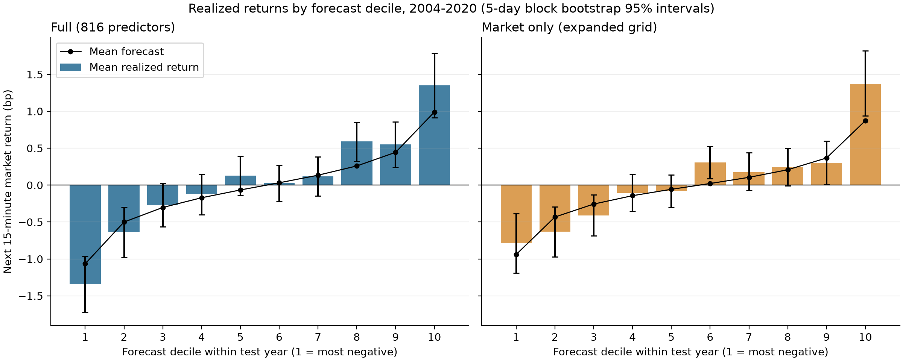

*Each test year's forecasts are sorted from most negative to most positive and split into ten equal groups (deciles). The bars show the average of the subsequent market returns for each group. Bars rising from left to right mean that higher forecasts tend to be followed by higher returns.*

---

## What I built

### Reproduced from the paper

- **Data pipeline.** Converted 2.45 million one-minute timestamps for 272
  portfolios (1996–2020) into 15-minute returns. Overnight returns are kept separate, and shortened trading days are kept as observed, without filling missing intervals.
- **Descriptive statistics.** Reproduced the paper's summary table of return,
  volatility, jump and correlation statistics for each portfolio group, its
  profile of returns across the trading day, and its correlation heatmaps
  ([Section 2](#2-data-and-descriptive-analysis)).
- **Forecasting experiment.** Built 816 predictors and re-estimated
  Ridge, Lasso and Elastic Net once a year, each time on all earlier data. The
  out-of-sample R² is 0.171%, 0.151% and 0.151% ([Section 4](#4-model-comparison)).

### My extensions beyond the paper

| Extension | Question it answers | Section |
|---|---|---|
| Paired trading-day block bootstrap | Are the differences between models real, or could they be luck? | [4.2](#42-uncertainty-analysis) |
| Predictor ablation (removing groups of predictors and refitting) | Which groups of portfolios carry the predictive information? | [5](#5-which-predictors-matter) |
| Exact year-by-year breakdown of the accuracy gain | Is the advantage spread across years or concentrated in a few? | [5](#5-which-predictors-matter) |
| Trading evaluation with transaction costs | Do the forecasts translate into profits, and how much cost can they absorb? | [6](#6-from-forecasts-to-trading) |
| Volatility-regime and time-of-day breakdown | Under which market conditions does the advantage appear? | [6.5](#65-when-does-the-full-model-help) |


### Contents

1. [Key concepts](#1-key-concepts)
2. [Data and descriptive analysis](#2-data-and-descriptive-analysis)
3. [Forecasting design](#3-forecasting-design)
4. [Model comparison](#4-model-comparison)
5. [Which predictors matter?](#5-which-predictors-matter)
6. [From forecasts to trading](#6-from-forecasts-to-trading)
7. [Limitations](#7-limitations)
8. [Reproduce the analysis](#8-reproduce-the-analysis)
9. [Repository guide](#9-repository-guide)

---

## 1. Key concepts

### Returns and units

- **Simple return.** The percentage change in value over a period:
  $r_t = P_t / P_{t-1} - 1$, where $P_t$ is the value at time $t$. A move from
  100 to 101 is a return of 0.01 (1%).
- **Log return.** $\log(1 + r_t)$. Log returns add up over time, so the return
  over 15 minutes is the sum of the 15 one-minute log returns. For small
  returns, simple return and log return are nearly equal.
- **Basis point (bp).** One hundredth of a percent: 1 bp = 0.01% = 0.0001. The
  standard deviation of 15-minute market returns is roughly 18 bp.
- **Percentage point (pp).** The difference between two percentages. Going from
  0.075% to 0.171% is an increase of 0.096 pp.
- **Annualized.** Rescaled to a one-year horizon so that numbers measured over
  different periods can be compared. A year has about 252 trading days.
  Average returns scale with time (multiply by 252). Volatility scales with the
  square root of time (multiply by $\sqrt{252}$).

### Portfolios and factors

- **Portfolio.** A basket of stocks whose return is the weighted average of its
  members' returns.
- **The market.** A portfolio of essentially all US stocks, weighted by company
  size. Its next 15-minute return is what this project predicts.
- **Long and short.** Being *long* means owning an asset, so you gain when it
  rises. Being *short* means borrowing an asset and selling it, then buying it
  back later to return it, so you gain when it falls.
- **Factor portfolio.** A portfolio that is long one group of stocks and short
  another, chosen by a stock characteristic. Its return is the long group's
  return minus the short group's, so it measures how one kind of stock performs
  *relative to* another, with the overall market's movement largely cancelled.
- **FF6.** The five Fama–French factors plus momentum:
  - market;
  - size (small minus big companies);
  - value (cheap minus expensive);
  - profitability (robust minus weak);
  - investment (conservative minus aggressive asset growth);
  - momentum (recent winners minus recent losers).
- **Industry portfolios.** 48 portfolios that group stocks by business sector
  (for example banks, utilities, retail).
- **Characteristic portfolios and the "factor zoo".** Academic research has
  proposed hundreds of stock characteristics that seem to predict returns, and
  this crowd of factors is called the *factor zoo*. This project uses 218 of
  them. In the descriptive statistics, each is oriented by its published sign
  so that its long side is the side expected to earn more.

### Risk and volatility

- **Volatility.** How much returns fluctuate, measured by their standard
  deviation. Higher volatility means bigger swings in either direction.
- **Realized variance (RV).** Variance measured from high-frequency data: the
  sum of squared returns over a period, $RV = \sum_t r_t^2$. Its square root is
  *realized volatility*.
- **Overnight return.** The price change between one day's close (16:00) and
  the next day's open (09:30). No regular trading happens in between, so it is
  treated separately from the 15-minute returns within the trading day.

### Forecast evaluation

- **Out-of-sample.** A forecast is out-of-sample if the model was fitted
  without seeing the period being forecast. This is the honest way to measure
  predictive power.
- **Out-of-sample $R^2$.** The percentage reduction in squared forecast error
  compared with always predicting a return of zero:

  $$R^2_{OOS} = 1 - \frac{\sum_t (y_t - \hat{y}_t)^2}{\sum_t y_t^2},$$

  where $y_t$ is the realized return and $\hat{y}_t$ the forecast. A value of 0
  means no better than predicting zero, and a negative value means worse. Stock
  prices are very close to unpredictable over short horizons, so an $R^2$ of a
  few tenths of a percent is economically meaningful when it is earned on
  thousands of forecasts a year.

### Trading terms

- **Notional.** The fixed amount of money a strategy trades with. Results scale in proportion to it, so they are reported per
  \$1 of notional.
- **Position.** $w_t$ is how much of the market is held during interval $t$,
  as a multiple of the notional.
- **Profit and loss (P&L).** The gain or loss from a position:
  $\text{P\&L}_t = w_t \times r_t$, as a fraction of the notional.
- **Gross vs. net.** *Gross* means before trading costs and *net* means after.
- **Turnover.** The total amount traded, $\sum_t |w_t - w_{t-1}|$, in units of
  notional. Moving from long (+1) to short (−1) trades 2 units: sell what you
  own, then short the same amount again.
- **Sharpe ratio.** Average return per unit of volatility; the standard measure
  of risk-adjusted performance:

  $$\text{Sharpe} = \frac{\text{mean(daily P\&L)}}{\text{standard deviation(daily P\&L)}} \times \sqrt{252}.$$

  Roughly, a Sharpe ratio of 1 means one year's average gain equals one
  standard deviation of the year's P&L. 
- **Break-even cost.** The cost per unit traded at which total net P&L is
  exactly zero: total gross P&L divided by total turnover.
- **Hit rate.** The share of forecasts whose sign (up or down) was correct.
- **Maximum drawdown.** The largest fall in cumulative P&L from a previous peak:
  the worst loss an investor would have experienced from a high point.

---

## 2. Data and descriptive analysis

The descriptive sample covers **1996–2020**: 300 monthly files containing
2,454,420 one-minute timestamps on 6,295 trading days, each with a return for
every portfolio. The 272 portfolios
are 6 FF6 factors, 48 industry portfolios and 218 characteristic portfolios.

**From one-minute to 15-minute returns.** Each trading day starts with one observation at 09:30, which is the overnight
return from the previous close. It is followed by 390 one-minute returns
(09:31–16:00). The one-minute returns are combined within each day into
15-minute returns. For example, the interval labeled 09:45 contains the minutes
09:31–09:45. The overnight observation stays separate. Shortened sessions,
such as the day after Thanksgiving, are kept as observed, and missing intervals
are not filled with zeros. This gives **169,518 15-minute observations**,
including the overnight ones. The descriptive statistics use 15-minute log returns, and the
forecasts later use simple returns.

### Portfolio statistics

Averages of portfolio-level statistics within each group, in percent,
excluding overnight returns:

| Average statistic (%) | Market | FF6 | Industry 48 | Characteristic 218 |
|---|---:|---:|---:|---:|
| Annual log return | 1.07 | 3.74 | 1.32 | 2.93 |
| Annualized realized volatility | 14.42 | 8.59 | 19.62 | 8.87 |
| Relative jump measure | 2.76 | 4.75 | 5.21 | 4.69 |
| First-order autocorrelation | 3.56 | 6.11 | 3.28 | 4.00 |
| Correlation with market | 100.00 | 0.68 | 67.32 | −9.28 |

How each row is computed, for a portfolio's 15-minute log returns $r_t$ over 25
years:

- **Annual return:** $\sum_t r_t / 25$.
- **Annualized volatility:** $\sqrt{RV/25}$, where $RV = \sum_t r_t^2$.
- **Relative jump measure:** the share of variance coming from sudden large
  price moves ("jumps") rather than continuous movement, estimated as
  $(RV - BP)/RV$. Here $BP = \frac{\pi}{2}\sum_t |r_t\, r_{t-1}|$ is *bipower
  variation*, a variance estimate that is largely unaffected by jumps.
- **First-order autocorrelation:** $\sum_t r_t r_{t-1} / RV$, which measures
  how much one interval's return resembles the next. Positive values mean some
  continuation, which is the basic reason prediction might be possible.
- **Correlation with the market:** the same cross-product normalized by both
  portfolios' realized volatilities.

These are realized-moment statistics rather than centered sample correlations
or formal jump tests.

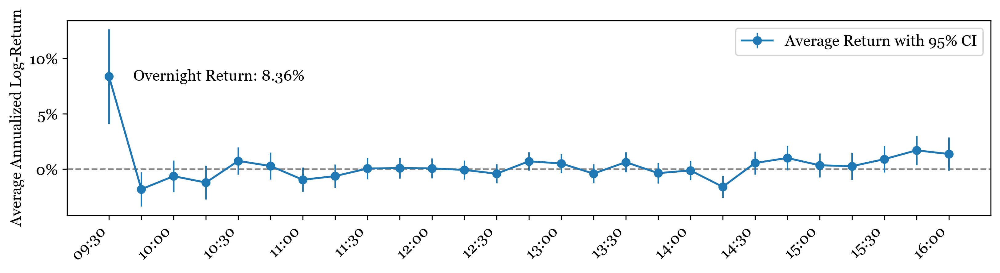

Average annual market return earned in each 15-minute interval, 1996–2020, with
95% error bars of half-width $1.96\sqrt{\sum r^2}/25$. **The overnight return
contributes 8.36% per year**, against about **1.07%** from all regular-session
intervals combined. Most of the stock market's long-run gain arrives while the
market is closed.

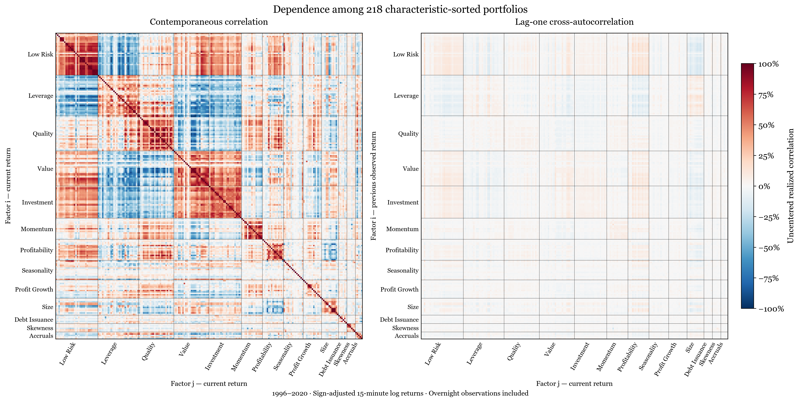

The left panel shows how strongly the 218 characteristic portfolios move
together *in the same* 15-minute interval. The right panel shows how strongly
each portfolio's return predicts each other portfolio's return in the *next*
interval (rows are lagged factors, columns are current factors). Both panels
include overnight returns. Movement in the same interval is strong, and
next-interval dependence is much weaker. That pattern motivates
**regularization**: many weak, correlated signals have to be combined to avoid
overfitting.

---

## 3. Forecasting design

### Target and predictors

The **target** $y_t$ is the market's simple return over one 15-minute interval
of the regular trading session (09:30–16:00, US Eastern time). The forecast for that interval is made at its start, using only
returns observed up to then.

The **predictors** describe how each of the 272 portfolios has behaved
recently, at three horizons:

| Predictor | Definition |
|---|---|
| `lag15` | The portfolio's previous 15-minute return |
| `avg60` | The average of the portfolio's previous four 15-minute returns (one hour) |
| `prevday` | The average of the portfolio's 15-minute returns on the previous trading day |

That gives 272 × 3 = **816 predictors**. Overnight returns are removed before
any lag or average is computed, so the hour and day averages reach back across days without using the overnight gap. The resulting dataset has 137,031 intervals starting 2000-01-04, of which **111,084 intervals on 4,280 trading days** (2004–2020) are forecast out-of-sample.

### Forecasting models

All three candidate models are linear regression models, but they penalize large
coefficients differently. This *regularization* trades a little bias for much
less overfitting when there are many noisy, correlated predictors.

- **Ridge.** Shrinks all coefficients toward zero smoothly:
  $\min_\beta \frac{1}{2n}\lVert y - X\beta\rVert^2 + \frac{\lambda}{2}\lVert\beta\rVert_2^2$.
- **Lasso.** Sets many coefficients exactly to zero, which selects predictors:
  $\min_\beta \frac{1}{2n}\lVert y - X\beta\rVert^2 + \alpha\lVert\beta\rVert_1$.
- **Elastic Net.** Mixes the two penalties:
  $\alpha\rho\lVert\beta\rVert_1 + \frac{\alpha(1-\rho)}{2}\lVert\beta\rVert_2^2$.

| Model | Penalty values searched |
|---|---|
| Ridge | 100 values of $\lambda$ from $e^{-1}$ to $e^{8}$, evenly spaced on a log scale |
| Lasso | 100 values of $\alpha$ from $e^{-6}$ to $e^{-1}$ |
| Elastic Net | 50 values of $\alpha$ from $e^{-6}$ to $e^{1}$, each with 50 values of $\rho$ from 0.05 to 0.95|

### Annual re-estimation without look-ahead

Each test year is forecast by models fitted only on earlier data:

1. **Split history.** All data from 2000 up to the end of the previous year
   are split by calendar time. The first 80% is *training* data and the last
   20% is *validation* data. For example, for 2004, training runs to
   2003-03-13 and validation from 2003-03-14 to 2003-12-31: 20,712 training,
   5,235 validation and 6,541 test intervals.
2. **Standardize.** Each predictor and the target are rescaled to mean 0 and
   standard deviation 1, using the training period's means and standard
   deviations only. For the target, that is
   $z = (y - \bar{y}_{train}) / s_{train}$.
3. **Tune.** Each candidate penalty is fitted on training data and scored by
   its mean squared error on the validation data, in return units. The penalty
   with the lowest validation error is kept.
4. **Forecast.** The selected model, fitted on training data only, forecasts
   every interval of the test year. It predicts the *standardized* target
   $\hat{z}$, so each forecast is converted back to a return:

   $$\hat{y} = \bar{y}_{train} + s_{train}\,\hat{z}.$$

   Each forecast is therefore the training-period average return plus an
   adjustment driven by the predictors. When every predictor equals its
   training average, the adjustment is zero and the forecast is just the
   training average.

This repeats for every year from 2004 to 2020, so all 111,084 forecasts are
out-of-sample.

### Pooled R²

Accuracy is summarized by **pooled $R^2$**, computed once from all 111,084 test
intervals together rather than averaged across years. Pooled $R^2$ equals a
weighted average of the yearly $R^2$ values, with each year weighted by its
sum of squared returns. Volatile years therefore carry more weight.

---

## 4. Model comparison

### 4.1 Forecast accuracy

All three models forecast exactly the same 111,084 test intervals.

| Model | Out-of-sample R² (%) |
|---|---:|
| Ridge | 0.1714 |
| Lasso | 0.1511 |
| Elastic Net | 0.1505 |
| Always predict zero (benchmark) | 0 |
| Always predict the training-period mean | −0.0011 |

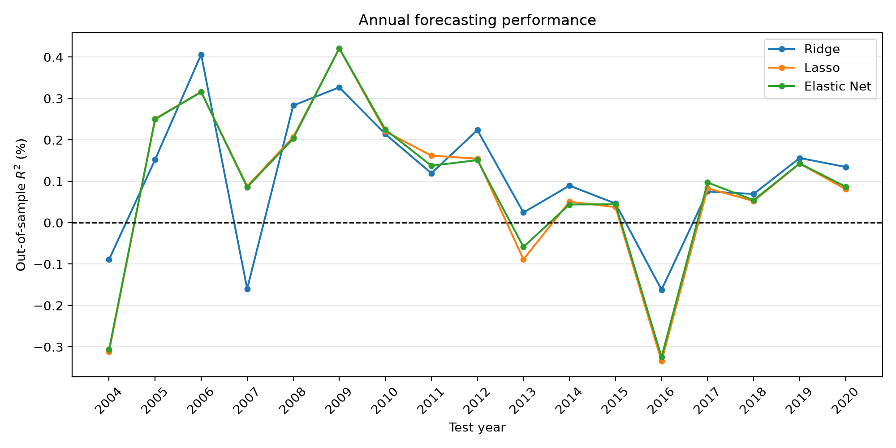

- **All three models beat the zero forecast** over the full test period, and
  the values match the paper to within 0.003 percentage points.
- **Ridge has the highest point estimate.** Whether its lead is real or luck is
  the question for Section 4.2.
- **Lasso and Elastic Net are almost the same model here.** Their forecasts
  have correlation 0.998, and the root-mean-square difference between them is
  0.037 bp.
- **The historical average does not help.** Predicting the training-period
  mean does slightly *worse* than predicting zero, because at a 15-minute
  horizon the average return is tiny and too noisy to estimate.
- **Accuracy varies a lot from year to year**. Ridge's annual $R^2$
  ranges from −0.16% (2016) to 0.41% (2006) and is negative in 3 of 17 years.
  Pooled $R^2$ is driven most by volatile years such as 2008.

### 4.2 Uncertainty analysis

The values above come from one particular 17-year history. A different history
would give somewhat different numbers. The **bootstrap** estimates how much
they could plausibly vary by resampling the observed trading days many times
and recomputing each statistic. It works in four steps.

**Step 1: summarize each trading day with three kinds of sums.** For trading
day $d$, with realized returns $y_t$ and model $m$'s forecasts
$\hat{y}_{m,t}$ in its intervals $t$:

| Daily sum | Formula | Meaning |
|---|---|---|
| Interval count | $n_d$ | Number of 15-minute intervals that day (usually 26) |
| Squared returns | $S_d = \sum_{t \in d} y_t^2$ | The squared error a zero forecast would make that day |
| Squared errors of model $m$ | $SSE_{m,d} = \sum_{t \in d} (y_t - \hat{y}_{m,t})^2$ | Model $m$'s squared forecast error that day |

Pooled $R^2$ can be computed exactly from these daily sums:

$$R^2_m = 1 - \frac{\sum_d SSE_{m,d}}{\sum_d S_d}.$$

The 111,084 intervals therefore reduce to 4,280 daily rows. Each day stays together as one unit, and a day with more intervals
automatically carries more weight.

**Step 2: draw a new history from blocks of days.** Pick a random starting
day, take it and the next 4 trading days (a 5-day block), and repeat until
4,280 days have been drawn. A block that runs past the last day wraps around
to the first. A day can be drawn more than once and then counts each time.

**Step 3: recompute.** Use the formula above on the drawn days to get each
model's $R^2$ and the differences between models.

**Step 4: repeat.** Repeat Steps 2–3 5,000 times. The 2.5th and 97.5th
percentiles of the 5,000 values form the **95% bootstrap percentile interval**.

**Why blocks of days, not single intervals?** The bootstrap assumes the
resampled pieces are independent. Single intervals are not: a model that is
wrong at 10:00 on a volatile day is often wrong at 10:15 too, and volatile days
cluster over weeks. Resampling single intervals would break those links and
make the intervals too narrow. Whole days keep within-day dependence, and
multi-day blocks keep short-run volatility clustering. Results are reported for
5-day, 10-day and 20-day blocks; similar intervals across lengths mean
the choice of length does not matter much.

**Why "paired"?** In every draw, all models are scored on the *same* drawn
days, and their difference is computed inside that draw. Most of each model's
squared error is the unpredictable part of the return, which all models share.
When one model has an unlucky draw, the others usually do too. Pairing cancels
this shared noise:

$$\mathrm{Var}(R^2_A - R^2_B) = \mathrm{Var}(R^2_A) + \mathrm{Var}(R^2_B) - 2\,\mathrm{Cov}(R^2_A, R^2_B).$$

The covariance is large, so a difference is far less uncertain than either
$R^2$ on its own.

**What the intervals do not cover.** The models are not refitted in each draw,
so the intervals measure uncertainty from *which days occurred*, given the
saved forecasts.


| Model | R² (%) | 95% interval (%) |
|---|---:|---:|
| Ridge | 0.1714 | [0.102, 0.239] |
| Lasso | 0.1511 | [0.083, 0.218] |
| Elastic Net | 0.1505 | [0.085, 0.216] |

| Difference in R² | Estimate (pp) | 95% interval (pp) |
|---|---:|---:|
| Ridge − Lasso | 0.020 | [−0.011, 0.050] |
| Ridge − Elastic Net | 0.021 | [−0.010, 0.050] |
| Lasso − Elastic Net | 0.0006 | [−0.003, 0.004] |

*Intervals use 5-day blocks; 10- and 20-day blocks give the same conclusions.*

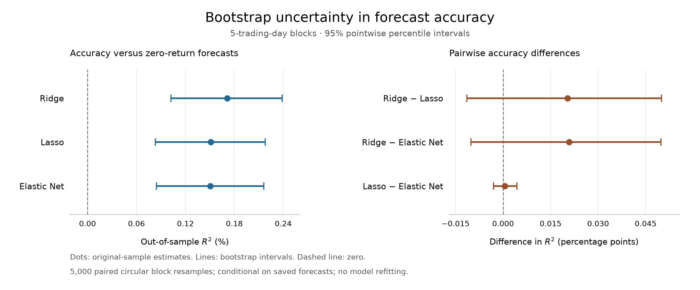

**Interpretation.**

- **The models genuinely beat the zero forecast.** Every model's interval lies
  entirely above zero at all three block lengths.
- **No model is clearly the best.** Every pairwise interval includes zero, so
  Ridge's higher point estimate could be luck. The accurate statement is that
  Ridge does *at least as well* as Lasso and Elastic Net.
- **A plausible reason Ridge is not worse:** the predictive information appears
  to be spread thinly over many correlated predictors. Ridge keeps every
  predictor with a small weight, which averages out noise, whereas Lasso tries
  to pick a few and drops the rest.

Ridge is used for the rest of the analysis. With all 816 predictors it is
called **Full**.

---

## 5. Which predictors matter?

Section 4 shows that the full model predicts better than zero. This section
asks *where that accuracy comes from*, using three analyses of Ridge:

| Analysis | What is done | Question it answers |
|---|---|---|
| Predictor ablation | Refit Ridge each year on a reduced predictor set, retuning its penalty: **market only** (the market's own 3 predictors) and **without characteristics** (the 54 FF6 and industry portfolios, 162 predictors). | Do the other 271 portfolios improve on the market's own past returns? Do the 218 characteristic portfolios add anything beyond industry and FF6? |
| Regularization sensitivity | Refit the market-only model with a wider range of penalties, including weaker ones and none at all. | Did the market-only model lose because its penalty choices were too limited, rather than because it lacks information? |
| Annual contributions | Split Full's total accuracy advantage into one piece per year, where the pieces add up exactly to the total. | Is Full's advantage spread across many years, or does it come from a few? |

All intervals use the same paired block bootstrap method as
[Section 4.2](#42-uncertainty-analysis).

### Removing predictor groups

Each reduced set gets fresh annual Ridge fits with its own tuned penalty, on
exactly the same rows and splits:

| Ridge predictors | Count | R² (%) | 95% interval (%) |
|---|---:|---:|---:|
| **Full:** all 272 portfolios | 816 | 0.1714 | [0.102, 0.239] |
| **Without characteristics:** industry + FF6 | 162 | 0.1665 | [0.073, 0.254] |
| **Market only** (original penalty grid) | 3 | 0.0751 | [−0.004, 0.147] |
| **Market only** (expanded penalty grid) | 3 | 0.0634 | [−0.022, 0.139] |

| Comparison | Difference (pp) | 95% interval (pp) |
|---|---:|---:|
| Full − market only (original grid) | 0.096 | [0.038, 0.159] |
| Full − market only (expanded grid) | 0.108 | [0.046, 0.176] |
| Full − without characteristics | 0.005 | [−0.042, 0.051] |

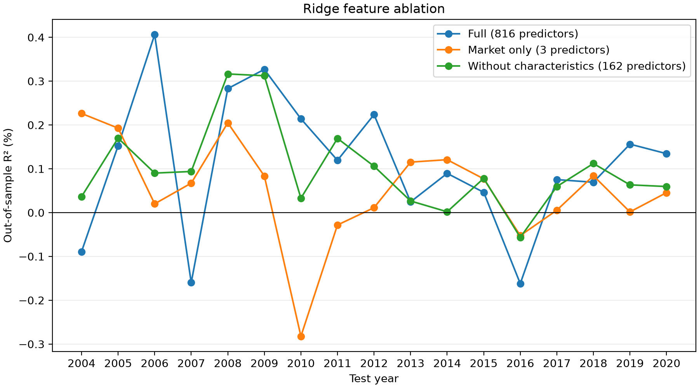

**Interpretation.**

- The other portfolios clearly add information beyond the market's own past
  returns. This holds at all three block lengths; for example, against the
  expanded-grid market-only model the 10-day interval is [0.048, 0.174] and
  the 20-day interval is [0.046, 0.176].
- Adding the 218 characteristic portfolios on top of industry and FF6
  portfolios gives no detectable further gain. That does not prove they are
  useless; the data simply cannot separate the two.

### Was the market-only benchmark handicapped?

In 7 of 17 years (2004, 2005, 2009, 2010, 2011, 2015, 2016), the market-only
model chose the *smallest* penalty on its grid ($\lambda \approx 0.368$). It might have
preferred an even weaker penalty if one had been available. To test this, the
grid was expanded:

- The 100 original values were kept.
- 60 smaller values were added (`geomspace(1e-6, exp(-1), 60, endpoint=False)`).
- Zero penalty was added (ordinary least squares).

All 161 candidates were scored on validation data only. The seven affected
years moved to weaker penalties (zero in 2009), and the other ten years were
unchanged.

The expanded benchmark did *worse* out of sample, by −0.012 pp with interval
[−0.022, −0.003], even though it fit the validation data at least as well. Both
versions are reported, and test results were not used to choose between them.
**Full's advantage does not come from a handicapped benchmark.**

### Which years produce the advantage?

Each year's contribution is the error reduction in that year divided by the
*whole period's* sum of squared returns:

$$\text{contribution}_{year} = 100 \times \frac{SSE^{\text{market only}}_{year} - SSE^{\text{full}}_{year}}{\sum_{\text{all years}} y_t^2}.$$

Here SSE is the sum of squared forecast errors.

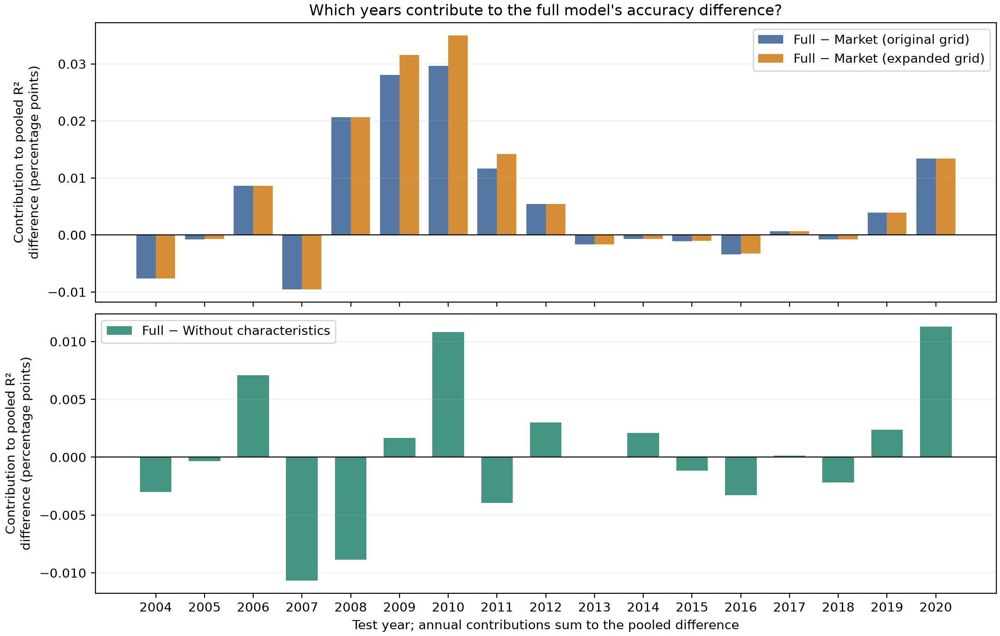

- Full beats market-only in 9 of 17 years.
- Against the expanded-grid benchmark, **2008–2010 contribute 0.087 pp, about
  81% of the 0.108 pp total**. All other years together contribute a net
  0.021 pp.
- Against the without-characteristics model, Full wins in 8 of 17 years, and
  gains and losses roughly cancel.

These years were identified after looking at the results, so this is
descriptive and not a causal claim. [Section 6.5](#65-when-does-the-full-model-help)
tests the obvious explanation: the 2008–2010 crisis was very volatile.

---

## 6. From forecasts to trading

An $R^2$ of 0.17% is hard to interpret in money terms. This section turns the
saved forecasts into simple trading rules and measures their profits, costs and
risk. Nothing is refitted.

**Setup** (code: [`strategy_evaluation.py`](src/hf_factor_zoo/strategy_evaluation.py)):

- **Models.** Full, compared with Market only (expanded penalty grid).
- **Timing.** Each position is opened at the forecast time and held for the
  next 15 minutes. All positions are closed at the end of every day (nothing is
  held overnight). Trades are assumed to fill instantly at the forecast time.
- **Traded asset.** The market portfolio itself. It cannot be bought directly,
  so the results are a gross proxy for an index fund such as SPY or an index
  future.
- **Uncertainty.** Every statistic comes with the same 5-day block bootstrap
  as above, with 5,000 resamples shared by all statistics. Intervals for 10-
  and 20-day blocks are in the saved tables and are similar.

### 6.1 Do larger forecasts come before larger returns?

The forecast-decile chart [above](#results-at-a-glance) sorts each year's
forecasts into ten equal groups and averages the realized return in each
group. Sorting within years stops the extreme deciles from being filled with
volatile crisis periods.

- Full: realized returns rise from **−1.35 bp** (lowest decile) to **+1.35 bp**
  (highest). The top-minus-bottom spread is **2.70 bp** [2.08, 3.31].
- Market only: the spread is 2.16 bp [1.55, 2.78].
- In both, realized returns track the forecasts closely, so the forecasts are
  roughly calibrated, not just correctly ordered.

| Hit rate (correct direction) | Estimate | 95% interval |
|---|---:|---:|
| Always predict "up" | 51.8% | [51.5, 52.1] |
| Full | 50.1% | [49.7, 50.4] |
| Market only | 49.2% | [48.9, 49.5] |

**Hit rate is not the right measure here.** The market rose in 51.8% of
intervals with a nonzero return, so always guessing "up" scores better than
either model. The models make money anyway (next section) because they tend to
be right on *large* moves and wrong on small ones, and profit depends on the
size of moves, not only their direction.

### 6.2 A simple trading rule

**Rule (sign).** Go long \$1 when the forecast is positive and short \$1 when it
is negative: $w_t = \text{sign}(\hat{y}_t)$.

Daily net P&L at a cost of $c$ per unit traded is

$$\text{net P\&L}_d = \sum_{t \in d} w_t\, r_t \;-\; c \times \text{turnover}_d,$$
$$\text{turnover}_d = |w_{\text{first}}| + \sum_{t \in d} |w_t - w_{t-1}| + |w_{\text{last}}|.$$

The turnover includes opening the first position and closing the last one each
day.

| Strategy | Forecasts used | Trading rule |
|---|---|---|
| Long only (session) | None | Buy \$1 of the market at the 09:30 open, hold it through the day, and sell at the 16:00 close; a benchmark for simply holding the market during trading hours. |
| Full: sign | Full | Long \$1 when the forecast is positive, short \$1 when it is negative. |
| Market only: sign | Market only (expanded grid) | The sign rule applied to Market only's forecasts. |


| Strategy (gross, 2004–2020) | Annual return | Annual volatility | Sharpe | Max drawdown | Average daily turnover |
|---|---:|---:|---:|---:|---:|
| Long only during the session | 2.5% | 15.2% | 0.17 [−0.27, 0.62] | 54.4% | 2.0 |
| Market only: sign | 27.8% | 14.3% | 1.94 [1.50, 2.37] | 15.6% | 18.3 |
| **Full: sign** | **31.3%** | **14.6%** | **2.15 [1.71, 2.58]** | **13.9%** | **16.8** |

*Returns are on \$1 of notional, summed rather than compounded, before costs.
"Average daily turnover" is in units of notional.*

The gross Sharpe ratio of 2.15 looks impressive, but the rule trades about 17
times its capital every day. Its **break-even cost is 0.74 bp** per unit traded
[0.57, 0.91]:

| Cost per unit traded | 0 bp | 0.25 bp | 0.5 bp | 1 bp | 2 bp |
|---|---:|---:|---:|---:|---:|
| Full: sign, net Sharpe | 2.15 | 1.42 | 0.69 | −0.74 | −3.48 |
| Market only: sign, net Sharpe | 1.94 | 1.13 | 0.33 | −1.23 | −4.20 |

For comparison, SPY's quoted buying and selling prices usually differ by one
cent. Each trade pays about half of that gap. At SPY prices of roughly \$70 to
\$370 over 2004–2020, half a cent is about 0.14–0.7 bp per unit traded, before
fees and market impact. So the edge is thin even for a low-cost trader, and it
disappears at 1 bp.


### 6.3 Trading only on strong forecasts

Small forecasts are mostly noise, yet trading them costs as much as trading
large ones. The **threshold rules** are based on the sign rule but take a position only when the absolute
forecast exceeds a percentile of the absolute forecasts over the **previous 20
trading days** (fewer at the very start of 2004). Using only past forecasts
keeps the rule free of look-ahead. The **linear** rule instead sizes positions
in proportion to the forecast, scaled by the average forecast size over the previous 20 trading days.

| Strategy using Full forecasts | Average absolute position | Average daily turnover | Gross Sharpe | Break-even cost | Net Sharpe at 0.5 bp | Net Sharpe at 1 bp |
|---|---:|---:|---:|---:|---:|---:|
| Sign| 1.00 | 16.8 | 2.15 | 0.74 bp | 0.69 | −0.74 |
| Above trailing median | 0.50 | 12.1 | 2.35 | 0.86 bp | 0.98 | −0.37 |
| Above trailing 75th percentile | 0.25 | 7.3 | 2.08 | 0.94 bp | 0.98 | −0.12 |
| Above trailing 90th percentile | 0.10 | 3.4 | 1.66 | **1.10 bp** | 0.90 | 0.15 |
| Linear | 1.01 | 25.1 | 2.22 | 0.85 bp | 0.91 | −0.40 |

*Average absolute position is the average of $|w_t|$ over all intervals. For
the threshold rules it equals the proportion of intervals with a position. For the
linear rule the position size varies, but averages about 1.*

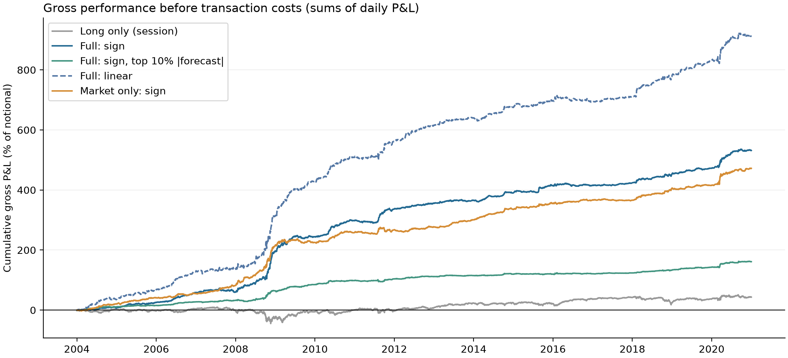

*Each line is the running total of daily gross P&L from 2004-01-02, in percent
of \$1 of notional, summed rather than compounded.*

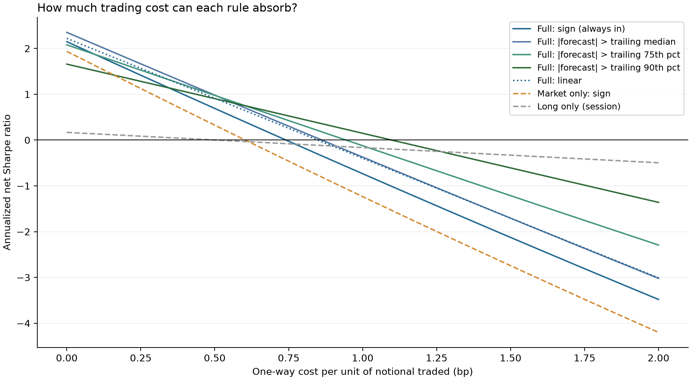

Trading only above the median raises the gross Sharpe ratio slightly (2.35 vs
2.15), but stricter thresholds lower it (2.08 and 1.66). In exchange, fewer
trades make the strategy cheaper to run. The 90th-percentile rule trades about a fifth as much as the
sign rule and keeps the highest net Sharpe once costs pass about 0.65 bp.


### 6.4 How close is trading performance to what R² implies?

Campbell and Thompson (2008) link forecast accuracy to the best attainable
Sharpe ratio. Assume the forecast is the true expected return and volatility is
constant. Then a position proportional to the forecast has a per-interval
Sharpe ratio of $\sqrt{R^2/(1-R^2)}$. Multiplying by
$\sqrt{\text{intervals per year}}$, about $\sqrt{6{,}540}$, annualizes it. Under
the same assumptions, no other way of trading on the forecast can do better, so
this is also an upper bound for the sign rule, which is shown for reference:

| Model | R² (%) | Implied Sharpe ceiling | Realized: linear | Realized: sign |
|---|---:|---:|---:|---:|
| Full | 0.171 | 3.35 [2.59, 3.96] | 2.22 [1.77, 2.66] | 2.15 [1.71, 2.58] |
| Market only | 0.063 | 2.04 [0, 3.02] | 1.11 [0.58, 1.74] | 1.94 [1.50, 2.37] |

Full's linear rule captures about **two-thirds of the theoretical ceiling**
(2.22 / 3.35). The gap is expected: real forecasts are noisy and volatility
changes over time. These ceilings are before costs, which is exactly where the
practical difficulty lies.

### 6.5 When does the full model help?

Section 5 found that Full's advantage over Market only comes mostly from
2008–2010 (about 81% of the total). Why those years? There are two possible
explanations:

- **Crisis-specific.** Something special happened during the 2008–2010
  financial crisis that made the 272 portfolios useful for forecasting, and it
  happened only in that crisis. If this is true, the advantage was a one-time
  event and should be gone after 2010.
- **Volatility-driven.** The 272 portfolios help whenever the market is
  volatile, in any year. 2008–2010 had more volatile days than any other
  period, so it shows the largest advantage. If this is true, the advantage
  should also appear on volatile days in other years, such as 2011 or 2020.

The difference matters for using the model today:

| | Crisis-specific | Volatility-driven |
|---|---|---|
| Is the advantage still useful after 2010? | No | Yes, on volatile days |

To tell them apart, each test day is classified by **ex-ante volatility**, a
volatility estimate built only from data available before the day opens:

$$\sigma_d = \sqrt{252 \times \tfrac{1}{5}\textstyle\sum_{k=1}^{5} RV_{d-k}}, \qquad RV_{d} = \sum_{t \in d} r_t^2.$$

Days are split into equal thirds (terciles) by $\sigma_d$, with cut-offs at
7.7% and 11.3% annualized. These figures cover only the trading session, so
they are lower than the usual quoted market volatility, which includes
overnight moves. They are also below the 14.42% in the portfolio statistics table (Section 2), because they are
boundaries between groups of days, not an average: most days are calm, and a
few very volatile days (for example in 2008) pull the average up. The cut-offs
use the whole sample, so this split describes the
data rather than forming a trading filter.

| Volatility tercile | Share of realized variance | R² gain within tercile (pp) | Contribution to the 0.108 pp total (pp) |
|---|---:|---:|---:|
| Low | 8% | −0.048 [−0.167, 0.068] | −0.004 [−0.014, 0.006] |
| Medium | 15% | −0.010 [−0.112, 0.094] | −0.001 [−0.017, 0.014] |
| High | 77% | **0.148 [0.073, 0.234]** | **0.113 [0.056, 0.178]** |

| Contribution of high-volatility days (pp) | 2004–2007 | 2008–2010 | 2011–2020 |
|---|---:|---:|---:|
| Estimate | −0.001 | 0.083 | **0.032** |
| 95% interval | [−0.013, 0.009] | [0.033, 0.142] | **[0.004, 0.062]** |

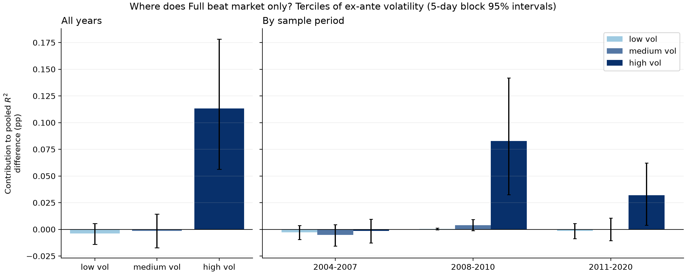

**Interpretation.**

- **All of Full's advantage comes from high-volatility days.** On calm days it
  is no better than the market-only model.
- **The effect is not only a crisis effect.** High-volatility days after 2010
  still show a positive contribution whose interval excludes zero, and a
  within-tercile R² gain of 0.103 pp [0.013, 0.199], though it is smaller than in
  2008–2010.
- High-volatility days are a third of the days but carry 77% of the realized
  variance, which is their weight in pooled R².
- The volatile days of 2004–2007 show no gain, so volatility is not the whole
  story.

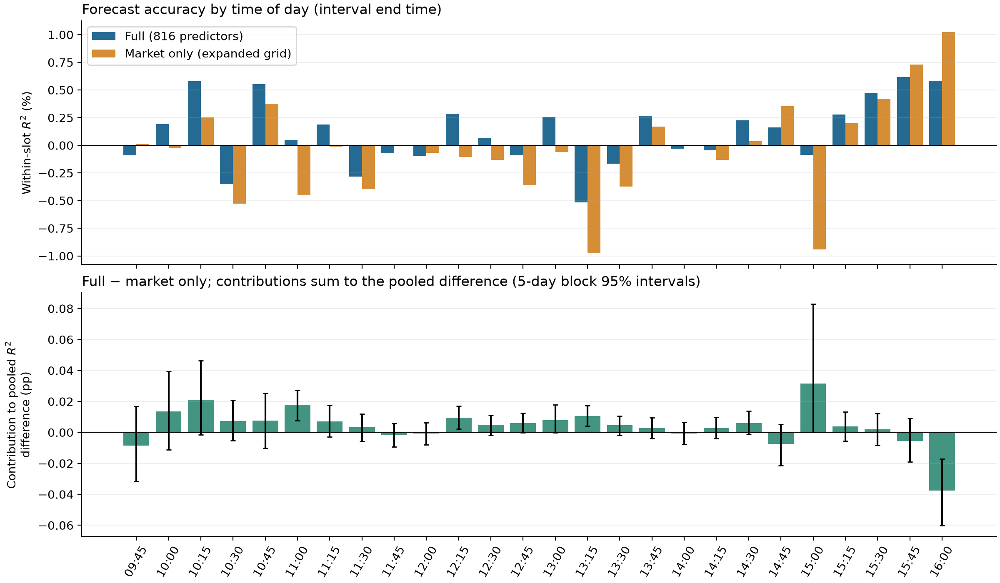

**Time of day.** Full beats market-only in 19 of the 26 intervals. The first
hour contributes 0.034 pp of the 0.108 pp total, the middle of the day
0.112 pp, and the last hour −0.037 pp. Almost all of that loss comes from the
**last interval (15:45–16:00)**, where Full is significantly *worse* than
market-only: −0.038 pp [−0.060, −0.017]. One possible reason is that the final minutes are dominated
by end-of-day order flow, which past portfolio returns would not capture; this
explanation is not tested here. With 26 intervals tested, a few intervals
will look significant by chance, so single-interval results should be read
cautiously.

---

## 7. Limitations

**Scope and reproduction differences**

- **Partial reproduction.** Observed factor returns are used to predict
  observed market returns. The paper's separate modelling of continuous and
  jump components, its full model ensemble and its SPY trading strategy are not
  reproduced. Section 6 is a simpler, separately designed evaluation.
  
**Statistical caveats**

- **The 95% intervals are approximate.** They come from the block bootstrap
  in Section 4.2, and there are three things they do not include:
  - The models are not refitted in each resample. They are fitted once for
    each test year, and their forecasts are saved. Each resample draws a new
    set of test days and recomputes R² from the same saved forecasts. So the
    intervals answer "with these fitted models, how much would R² change if
    different days had occurred?" They do not answer "if the training data
    had been a little different, how much would the coefficients, and so the
    forecasts, have changed?" That second source of uncertainty is not
    included, so the true uncertainty is somewhat larger than the intervals
    show.
  - Each interval is a 95% interval on its own. When many intervals are shown
    (for example, the 26 times of day), a few will exclude zero by chance.
- **Some analyses were designed after seeing results.** Every forecast uses
  only past data. But the later analyses (removing predictor groups, the wider
  penalty search, the trading rules and the volatility groups) were designed
  after seeing the first results for 2004–2020. So 2004–2020 is not completely
  new data for them. Testing on data after 2020 would be the cleanest check.
- **The volatility groups use future information.** The boundaries between
  low-, medium- and high-volatility days are computed from all days in
  2004–2020, so this split describes the past and cannot be used for trading
  in real time. The 2008–2010 period was also chosen after seeing the yearly
  results.

**Trading caveats**

- **Not directly tradable.** The market portfolio is a proxy. An index fund or
  future would track it closely but not exactly.
- **Simplified execution.** The evaluation assumes zero latency: trades fill
  at the forecast time at the 15-minute return's starting price. Costs are a
  flat amount per unit traded, without market impact, fees, borrowing costs or
  capacity limits.

---

## 8. Reproduce the analysis

### Environment and inputs

Use Python 3.13 or later and [uv](https://docs.astral.sh/uv/), from the
repository root:

```powershell
uv sync --locked
uv run ruff check src tests notebooks
uv run ruff format --check src tests notebooks
uv run pytest
```

The tests use small synthetic datasets, so they run without the source data.
GitHub Actions runs the same lint, format and test commands on every push to
`main` and every pull request ([`.github/workflows/ci.yml`](.github/workflows/ci.yml)).

The figures and summary tables in this repository can be reviewed without the
source data. Full reproduction needs the locally prepared input data. The
repository does not include a downloader and does not redistribute raw returns.

Supply 300 monthly Parquet files, `199601.parquet` through `202012.parquet`,
under `data/simple_returns_1min/`. Each needs:

- a sorted, unique datetime index in exchange-local time;
- finite decimal simple returns;
- the same 272 columns:
  - six `ff__*` columns: `mkt`, `smb`, `hml`, `rmw`, `cma`, `umd`;
  - 48 `ind48__*` columns;
  - 218 characteristic columns: 65 `cz__*` and 153 `jkp__*`.

Keep the 09:30 overnight row in these inputs. The feature builder removes it,
and the descriptive notebook uses it where specified.

The descriptive notebook also needs two metadata files from the paper's
replication materials. They are the authors' work, so they are not included in
this repository. Place them in a `docs/` folder:

- `docs/factor_cite_info_fmt.xlsx` supplies factor names, citations and signs.
- `docs/cluster_classifications.csv` maps characteristic identifiers to
  economic groups.

See the authors' [paper](https://doi.org/10.1287/mnsc.2023.01657) and
[supplement and replication materials](https://pubsonline.informs.org/doi/suppl/10.1287/mnsc.2023.01657)
for data context and access, and follow the source providers' terms.

### Descriptive analysis

```powershell
uv sync --locked --group notebooks
uv run --group notebooks jupyter lab notebooks/01_descriptive_analysis.ipynb
```

Run the notebook top to bottom from a fresh kernel.

### Build features and fit models

```powershell
uv run python -m hf_factor_zoo.data_processing
uv run python -m hf_factor_zoo.build_features
uv run python -m hf_factor_zoo.forecasting --model ridge
uv run python -m hf_factor_zoo.forecasting --model lasso
uv run python -m hf_factor_zoo.forecasting --model elastic_net
```

These commands build the 15-minute return and forecasting panels, then fit the
three models for 2004–2020. Use `--first-year 2004 --last-year 2004` for a
quick one-year run.

### Evaluate

```powershell
uv run python -m hf_factor_zoo.compare_forecast
uv run python -m hf_factor_zoo.bootstrap_forecast
uv run python -m hf_factor_zoo.feature_ablation --last-year 2020
uv run python -m hf_factor_zoo.market_sensitivity --last-year 2020
uv run python -m hf_factor_zoo.strategy_evaluation
```

- Comparison, bootstrap and strategy evaluation reuse saved predictions
  without refitting.
- Ablation refits the two reduced predictor sets. It defaults to a single-year
  2004 check, so pass `--last-year 2020` for the full study.
- Sensitivity refits only the market-only model with the expanded grid.
- The strategy evaluation needs the sensitivity outputs and the local
  forecasting panel. `--n-replicates 50` runs a quick check.
- Each command overwrites only its own results directory.

### Automated tests

The test suite (`tests/`, 42 tests) checks the most error-prone steps on
synthetic data:

- **Look-ahead bias.** A perturbation test replaces every return from a given
  time onward with new random values. All earlier features must stay identical,
  and overnight returns must never affect any feature. Selected features are
  also rebuilt by hand at the first usable day, a year boundary and the open
  and close. If `lag15` is deliberately changed to use the current return, 8
  of these tests fail.
- **Trading rules.** Thresholds and position scaling depend only on earlier
  days' forecasts, and ex-ante volatility ignores the same day. Turnover and
  P&L match a hand-worked example. Sharpe ratios computed from daily sums
  match a direct calculation.
- **Splits and metrics.** The 2004 training/validation cut-off matches the one
  reported above. Scalers use training rows only, and R² is measured against a
  zero forecast.
- **Statistics.** Bootstrap blocks are consecutive and wrap around the sample
  end, and resampled totals equal sums of the sampled days. Annual,
  time-of-day and volatility contributions add up to the pooled difference.

### Built-in checks

Checks that run inside the pipeline on the real data:

- **Data.** Portfolio counts, sorted unique timestamps and finite values.
- **Timing.** Every forecast time precedes its target, and the training,
  validation and test periods are in order.
- **Alignment.** Targets and baselines match across models, and inverse
  scaling is checked.
- **Bootstrap.** Daily sums reproduce the pooled R² exactly.
- **Sensitivity.** The original candidates' validation losses are reproduced.
- **Decompositions.** Year, time-of-day and volatility contributions each add
  up to the overall difference exactly.
- **Strategy inputs.** The returns used by the strategy evaluation match the
  forecasting panel.

---

## 9. Repository guide

| Path | Purpose |
|---|---|
| `notebooks/01_descriptive_analysis.ipynb` | Descriptive statistics, intraday return profile and correlation heatmaps |
| `src/hf_factor_zoo/data_processing.py` | Monthly loading and aggregation to 15-minute returns |
| `src/hf_factor_zoo/features.py`, `build_features.py` | Lagged predictors, timing checks and panel construction |
| `src/hf_factor_zoo/forecasting.py` | Annual estimation, penalty selection and forecasts |
| `src/hf_factor_zoo/compare_forecast.py` | Accuracy tables, forecast similarity and annual plot |
| `src/hf_factor_zoo/bootstrap_forecast.py` | Paired trading-day block bootstrap |
| `src/hf_factor_zoo/feature_ablation.py` | Predictor-group comparison |
| `src/hf_factor_zoo/market_sensitivity.py` | Expanded market-only search and annual contributions |
| `src/hf_factor_zoo/strategy_evaluation.py` | Forecast deciles, trading rules, costs, Sharpe ceiling, volatility and time-of-day analysis |
| `tests/` | Synthetic-data tests for timing, splits, metrics, bootstrap and trading rules |
| `.github/workflows/ci.yml` | Continuous integration: lint, format check and tests |
| `results/descriptive/` | Descriptive tables and figures |
| `results/forecasting/` | Summary tables and figures for each study |

Raw data, the authors' metadata files, fitted models, interval-level
predictions, daily P&L and bootstrap draws are kept out of version control. The committed results contain the
figures and summary tables used in this report.

**Reference:** Aleti, S., Bollerslev, T., and Siggaard, M. (2025). *Intraday
Market Return Predictability Culled from the Factor Zoo*. Management Science,
71(9), 7731–7751.
[doi:10.1287/mnsc.2023.01657](https://doi.org/10.1287/mnsc.2023.01657).

The factor data and the underlying forecasting design are credited to the
authors. This repository contributes the implementation of the partial
reproduction, the uncertainty analysis, predictor and regularization studies,
and the trading and regime evaluation.
