# Intraday Market Return Forecasting from the Factor Zoo

This project partially reproduces the forecasting experiment of
[Aleti, Bollerslev, and Siggaard (2025)](https://doi.org/10.1287/mnsc.2023.01657).
The first question is whether recent returns from 272 portfolios can help
predict the U.S. market's next 15-minute return. I compare Ridge, Lasso, and
Elastic Net on **111,084 out-of-sample intervals from 2004 through 2020**.
I then ask how much the other portfolios add beyond the market's own history,
when that improvement occurs, and how much trading cost the forecasts can absorb.

[Read the full report](report.pdf)

## Results at a glance

Brackets are 95% intervals from a paired block bootstrap of trading days.

| Question | Answer |
|---|---|
| Do the models beat a zero forecast, and does one model clearly beat the others? | **All three beat zero; none clearly beats the others.** Ridge has the highest pooled out-of-sample R², **0.171%** [0.102, 0.239]. Its lead over Lasso is 0.020 percentage points [−0.011, 0.050], an interval that includes zero. |
| Do the other 271 portfolios help beyond the market's own past? | **Yes.** Ridge with all 816 predictors beats market-only Ridge by **0.096 percentage points** [0.038, 0.159] on the original penalty grid, and by **0.108** [0.046, 0.176] when the market-only model may choose weaker penalties. |
| Could the forecasts make money after trading costs? | **Only barely.** A simple long/short rule has a **gross Sharpe of 2.15** [1.71, 2.58], but it trades 16.8 units of notional a day and breaks even at **0.74 bp per unit traded** [0.57, 0.91]. Trading only strong forecasts raises break-even to **1.10 bp**. As an illustration, paying half of a one-cent spread costs about 0.14–0.71 bp each way at SPY prices of \$70–\$370, before fees and market impact. |
| When does the full model help? | **On high-volatility days.** The third of days with the highest estimated volatility accounts for the net gain over market-only Ridge. Across all days, 2008–2010 account for about 81% of the pooled gain. High-volatility days in 2011–2020 still contribute **0.032 percentage points** [0.004, 0.062] to the full-sample gain. |

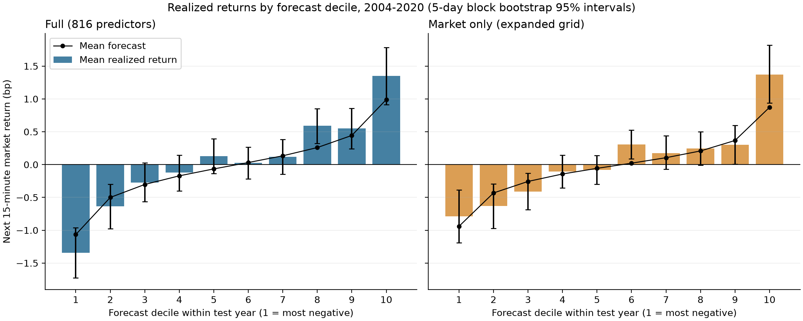

*Each year, the forecasts are ranked into ten groups. The bars show the
average realized 15-minute return for each group.*

## What I built

### Reproduced from the paper

- **Data pipeline.** Aggregates 2.45 million one-minute timestamps for 272
  portfolios into 15-minute returns, keeping overnight returns separate and
  shortened sessions as observed ([Section 2](#2-data-and-descriptive-analysis)).
- **Descriptive analysis.** The paper's portfolio statistics, intraday return
  profile, and dependence heatmaps.
- **Forecasting experiment.** 816 predictors; Ridge, Lasso, and Elastic Net
  refitted every year on an expanding window, with out-of-sample R² of 0.171%,
  0.151%, and 0.151%, within 0.003 percentage points of the published values
  ([Section 4.1](#41-forecast-accuracy)).

The paper also models continuous and jump components separately and studies
additional models, ensembles, and ETF execution; those parts are not reproduced.

### My extensions beyond the paper

| Extension | Question it answers | Section |
|---|---|---|
| Paired block bootstrap of trading days | Are the differences between models real, or could they be luck? | [4.2](#42-uncertainty-analysis) |
| Predictor ablation and expanded penalty grid | Do the other portfolios add information, and is the market-only benchmark fair? | [5](#5-which-predictors-matter) |
| Exact year-by-year decomposition of the gain | Is the advantage spread across years or concentrated in a few? | [5](#which-years-produce-the-advantage) |
| Trading evaluation with costs | Do the forecasts translate into profits, and how much cost can they absorb? | [6](#6-from-forecasts-to-trading) |
| Volatility-regime and time-of-day decomposition | Under which market conditions does the advantage appear? | [6.5](#65-when-does-the-full-model-help) |

## Contents

1. [Key concepts](#1-key-concepts)
2. [Data and descriptive analysis](#2-data-and-descriptive-analysis)
3. [Forecasting design](#3-forecasting-design)
4. [Model comparison and uncertainty](#4-model-comparison)
5. [Which predictors matter?](#5-which-predictors-matter)
6. [From forecasts to trading](#6-from-forecasts-to-trading)
7. [Limitations](#7-limitations)
8. [Reproduce the analysis](#8-reproduce-the-analysis)
9. [Repository guide](#9-repository-guide)

## 1. Key concepts

- **Simple return.** The percentage change in value over an interval. A move
  from 100 to 101 is a simple return of 1%.
- **Log return.** For a simple return $r$, the log return is $\log(1+r)$.
  Adding one-minute log returns gives the log return over the whole interval.
- **Basis point (bp).** One basis point is 0.01%, or 0.0001 in decimal units.
  A *percentage point* (pp) is the difference between two percentages. Moving
  from 0.075% to 0.171% is a gain of 0.096 pp.
- **Portfolio and factor.** A portfolio is a basket of stocks. Many factor
  portfolios are long one basket and short another, such as small stocks versus
  large stocks. The market portfolio is the broad, value-weighted U.S. stock
  portfolio used as the forecast target.
- **Volatility.** How much returns fluctuate. The descriptive analysis uses
  the square root of summed squared returns to measure realized volatility.
  The trading analysis uses the standard deviation of daily profit and loss.

## 2. Data and descriptive analysis

The 1996–2020 sample contains **2,454,420 one-minute timestamps** on
**6,295 trading days**. Each timestamp has returns for 272 portfolios. These
include the five Fama–French factors plus momentum (FF6), 48 industry portfolios,
and 218 characteristic portfolios. The characteristic portfolios are oriented
by their published signs for the descriptive analysis.

The pipeline sums one-minute log returns within each 15-minute interval. For
example, the 09:45 return combines observations from 09:31 through 09:45
(Eastern time). The 09:30 observation records the return from the previous
close to the current open and stays separate. A full session contributes 26
intraday returns, and shortened sessions contribute only their observed
intervals. The aggregated panel contains **169,518 rows**, including overnight
rows. The descriptive analysis uses log returns. The forecasting pipeline
converts the aggregates back to simple returns.

### Portfolio statistics

Each statistic is computed per portfolio, then averaged within its group.
The table excludes overnight returns and reports values in percent.

| Statistic (%) | Market | FF6 | Industry 48 | Characteristic 218 |
|---|---:|---:|---:|---:|
| Average annual log return | 1.07 | 3.74 | 1.32 | 2.93 |
| Annualized realized volatility | 14.42 | 8.59 | 19.62 | 8.87 |
| Relative jump measure | 2.76 | 4.75 | 5.21 | 4.69 |
| First-order autocorrelation | 3.56 | 6.11 | 3.28 | 4.00 |
| Correlation with the market | 100.00 | 0.68 | 67.32 | −9.28 |

Let $r_t$ be a portfolio's log return at observation $t$, $m_t$ the
market's log return at the same observation, and $`RV=\sum_t r_t^2`$ the portfolio's realized variance.

| Statistic | Calculation |
|---|---|
| Average annual log return | $`\sum_t r_t / 25`$. Log returns add across time, and the sample spans 25 years. |
| Annualized realized volatility | $`\sqrt{RV/25}`$. Realized variance over the sample is the sum of squared returns. |
| Relative jump measure | $`(RV-BP)/RV`$, where $`BP=\frac{\pi}{2}\sum_{t\ge 2}\lvert r_t r_{t-1}\rvert`$ is bipower variation. The gap estimates the share of variation associated with jumps. |
| First-order autocorrelation | $`\sum_{t\ge 2}r_t r_{t-1}/RV`$. It pairs each return with the preceding observed intraday return. |
| Correlation with the market | $`\frac{\sum_t r_t m_t}{\sqrt{RV}\sqrt{\sum_t m_t^2}}`$. It measures how much the portfolio and the market move together in the same interval. |

The last two rows use uncentered returns. The relative jump measure is descriptive.

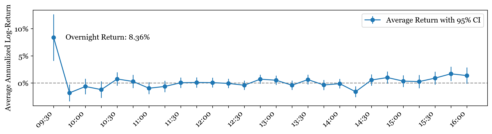

*The average annual market log return is 8.36% from the overnight interval
and 1.07% from all regular-session intervals combined: most of the market's
long-run gain arrives while the market is closed. For each clock time,
the figure uses approximate 95% error bars with half-width
$`1.96\sqrt{\sum_t r_t^2}/25`$, summing squared returns for that clock time.*

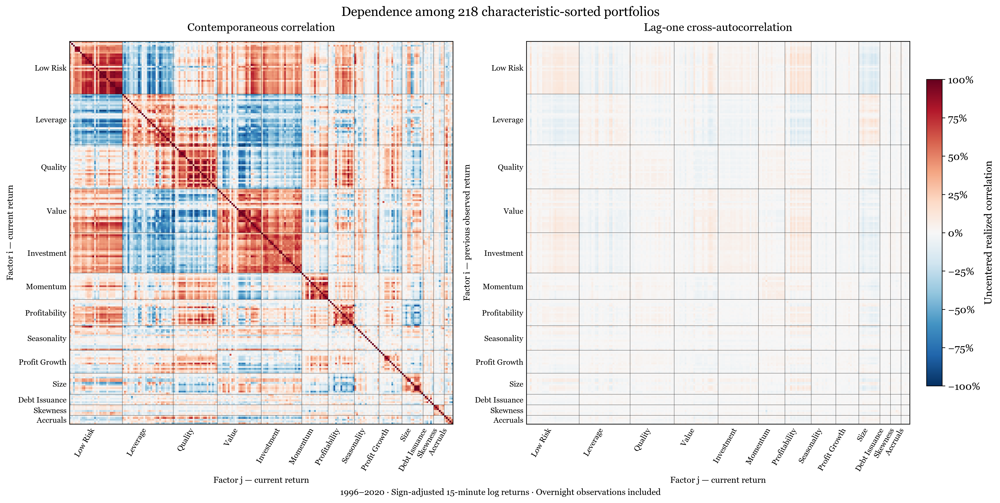

*The left panel pairs returns in the same interval. The right pairs the
preceding observed return of the row portfolio with the current return of the
column portfolio. Both include overnight observations. Same-interval
co-movement is stronger than lagged co-movement.*

The forecasting models use lagged returns. With many predictors that move
together and comparatively weak lagged relationships, regularization helps
limit how much the fit responds to noise in individual predictors.

## 3. Forecasting design

### Target and predictors

The target is the market's **simple return over the next 15 minutes of regular
trading**. For a target ending at 10:15, the forecast uses information available
at 10:00. Each portfolio contributes three predictors:

| Predictor | Definition |
|---|---|
| `lag15` | Most recent completed 15-minute intraday return |
| `avg60` | Average of the four most recent completed 15-minute intraday returns |
| `prevday` | Average 15-minute intraday return on the previous trading day |

This gives **816 predictors**. The feature builder removes overnight returns
first. Near the open, the previous observations used by `lag15` and `avg60`
can come from the preceding trading day.

### Forecasting models

All three models minimize a squared-error loss plus a penalty on the
standardized regression coefficients. Ridge shrinks coefficients toward
zero. Lasso can set coefficients to zero. Elastic Net combines both penalties.

| Model | Penalty | Grid |
|---|---|---|
| Ridge | $`\frac{\lambda}{2}\lVert\beta\rVert_2^2`$ | 100 log-spaced values of $\lambda$ from $e^{-1}$ to $e^8$ |
| Lasso | $`\alpha\lVert\beta\rVert_1`$ | 100 log-spaced values of $\alpha$ from $e^{-6}$ to $e^{-1}$ |
| Elastic Net | $`\alpha\rho\lVert\beta\rVert_1+\frac{\alpha(1-\rho)}{2}\lVert\beta\rVert_2^2`$ | 50 log-spaced values of $\alpha$ from $e^{-6}$ to $e^1$ and 50 evenly spaced values of $\rho$ from 0.05 to 0.95 |

The penalty terms are written for a squared-error loss divided by $2n$,
where $n$ is the training sample size. For Ridge, the implementation passes
$`n\lambda`$ as scikit-learn's `alpha`.

### Annual re-estimation without look-ahead

1. For each test year, take the history from January 2000 through the previous
   year. Use the first 80% of that calendar span for fitting and the last 20%
   for validation. For the 2004 forecasts, the last fitting observation is
   March 13, 2003, and validation runs from March 14 through December 31,
   2003. That gives 20,712 fitting, 5,235 validation, and 6,541 test intervals.
2. Standardize predictors and target using the fitting period's means and
   standard deviations. Fit each candidate on that period and select the
   penalty with the lowest validation mean squared error in return units.
3. Forecast the entire test year with the selected fit. For the next test year,
   expand the history by one year and repeat. Each candidate's coefficients and
   scaling come from the fitting period, with the validation period used to
   choose the penalty.

The regression is fitted on centered data without an additional intercept.
To convert a standardized forecast $`\hat z_t`$ back to return units, multiply
it by the target's training standard deviation $`s_{\mathrm{train}}`$ and
add its training mean $`\bar y_{\mathrm{train}}`$.

```math
\hat y_t = \bar y_{\mathrm{train}} + s_{\mathrm{train}}\,\hat z_t.
```

Think of this as the training-period mean market return plus an adjustment
from the predictors. If each predictor equals its own training mean, all the
standardized inputs are zero and the forecast is the mean market return.

### Pooled R²

Out-of-sample R² measures the reduction in squared error against predicting
zero. Here $y_t$ is the realized return and $`\hat y_t`$ is the forecast.

```math
R^2_{\mathrm{OOS}}
= 1-\frac{\sum_t (y_t-\hat y_t)^2}{\sum_t y_t^2}.
```

Positive values mean the model beat zero, and negative values mean zero did
better. Pooled R² uses all **111,084 test intervals on 4,280 trading days**.
Equivalently, it averages yearly R² values weighted by each year's sum of
squared market returns. Years with larger market swings tend to carry more
weight.

## 4. Model comparison

### 4.1 Forecast accuracy

| Model | Pooled R² (%) | Published R² (%) |
|---|---:|---:|
| Ridge | **0.1714** | 0.172 |
| Lasso | 0.1511 | 0.151 |
| Elastic Net | 0.1505 | 0.153 |
| Zero forecast | 0 | — |
| Training-mean forecast | −0.0011 | — |

Published values are from the observed-return specification in
[Table 2 of the paper](https://public.econ.duke.edu/~boller/Papers/MS_2025.pdf).
All three model scores are within 0.003 percentage points of the published
values. The training-mean baseline scores slightly below the zero forecast
over the pooled test sample.

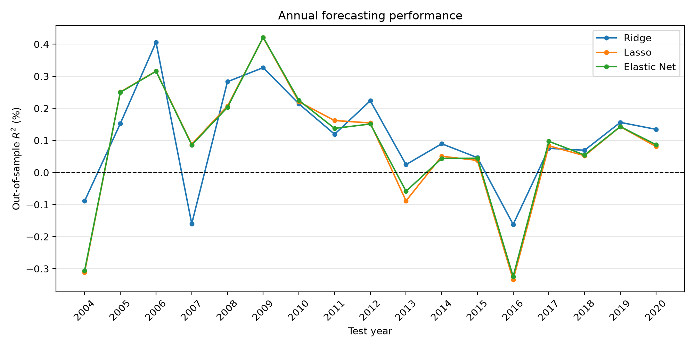

- Ridge ranges from **−0.16% in 2016 to 0.41% in 2006** and scores below zero
  in 3 of the 17 test years. Volatile years such as 2008 carry more weight in
  the pooled score.
- Lasso and Elastic Net produce nearly identical forecasts. Across matched
  test intervals, their Pearson correlation is **0.998** and the
  root-mean-square difference is **0.037 bp**. The correlation measures
  co-movement, and the RMS difference measures how close the forecast values are.

### 4.2 Uncertainty analysis

Ridge has the highest point estimate, but the difference from Lasso and
Elastic Net is only about 0.02 percentage points. To see how sensitive that
gap is to the days in the test sample, resample blocks of trading days and
recompute the scores from the saved forecasts.

For each day $d$, store the zero forecast's sum of squared errors
$`S_d=\sum_{t\in d}y_t^2`$ and each model's squared error
$`E_{m,d}=\sum_{t\in d}(y_t-\hat y_{m,t})^2`$. Adding the daily totals gives
the same pooled score as adding all the interval-level errors directly.

```math
R_m^2 = 1-\frac{\sum_d E_{m,d}}{\sum_d S_d}.
```

1. Draw starting days with replacement and take consecutive blocks of five
   trading days. Wrap from the last day to the first when needed. Keep 4,280
   sampled days, counting repeat selections each time.
2. Compute each model's pooled R² on the **same sampled days**. All intervals
   in a day stay together. A day's weight in the pooled score is proportional
   to its sum of squared market returns.
3. Subtract each pair of scores within the draw. The resulting distribution
   answers how much one model tends to improve on the other on matched days.
4. Repeat 5,000 times. Use the 2.5th and 97.5th percentiles of the resulting
   values for the 95% interval.

Whole days retain within-day dependence. Consecutive blocks also retain some
dependence across nearby days. The main conclusions hold with 10- and 20-day
blocks as well.

Pairing matters because the same draw can move both scores in the same
direction. For example, if two scores fall from 0.30% and 0.28% to 0.08% and
0.06%, the gap stays at 0.02 percentage points. Positive covariance between
the scores across draws reduces the variance of their difference.

```math
\mathrm{Var}(R_A^2-R_B^2)
=\mathrm{Var}(R_A^2)+\mathrm{Var}(R_B^2)
-2\,\mathrm{Cov}(R_A^2,R_B^2).
```

| Model | R² (%) | 95% interval (%) |
|---|---:|---:|
| Ridge | 0.1714 | [0.102, 0.239] |
| Lasso | 0.1511 | [0.083, 0.218] |
| Elastic Net | 0.1505 | [0.085, 0.216] |

| Paired difference | Estimate (pp) | 95% interval (pp) |
|---|---:|---:|
| Ridge − Lasso | 0.020 | [−0.011, 0.050] |
| Ridge − Elastic Net | 0.021 | [−0.010, 0.050] |
| Lasso − Elastic Net | 0.0006 | [−0.003, 0.004] |

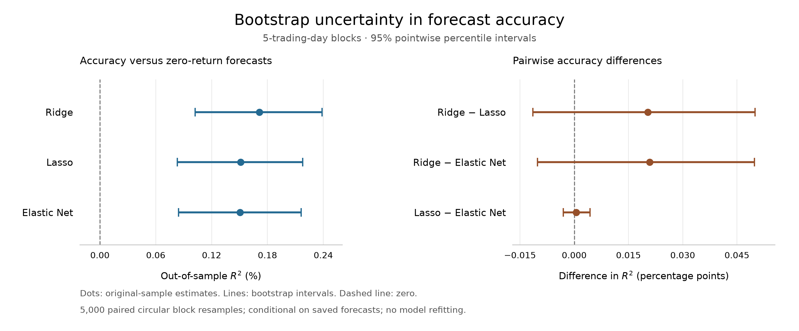

All three models' intervals are above zero. Each pairwise difference interval
includes zero. The rest of the analysis uses Ridge, which has the highest point
estimate. **Full** refers to Ridge with all 816 predictors.

## 5. Which predictors matter?

Section 4 shows that the full model improves on predicting zero. The next
question is whether the other portfolios add predictive information beyond
the market's own return history. Market-only Ridge uses the same three return
features for the market alone. Ridge without characteristic portfolios asks
whether those 218 portfolios add anything beyond the Fama–French, momentum,
and industry series.

Each reduced model uses Full's fitting procedure, chronological splits, and
test intervals. It selects its own penalty each year on the validation data.

| Ridge feature set | Predictors | R² (%) | 95% interval (%) |
|---|---:|---:|---:|
| Full | 816 | 0.1714 | [0.102, 0.239] |
| Fama–French factors, momentum, and industries | 162 | 0.1665 | [0.073, 0.254] |
| Market only, original penalty grid | 3 | 0.0751 | [−0.004, 0.147] |
| Market only, expanded penalty grid | 3 | 0.0634 | [−0.022, 0.139] |

| Full minus comparison model | R² gain (pp) | 95% paired interval (pp) |
|---|---:|---:|
| Market only, original grid | **0.096** | [0.038, 0.159] |
| Market only, expanded grid | **0.108** | [0.046, 0.176] |
| Without characteristic portfolios | 0.005 | [−0.042, 0.051] |

Full improves on market-only Ridge under both penalty grids. The incremental
gain from adding the 218 characteristic portfolios to the industry and
Fama–French predictors is small, and its interval includes zero.

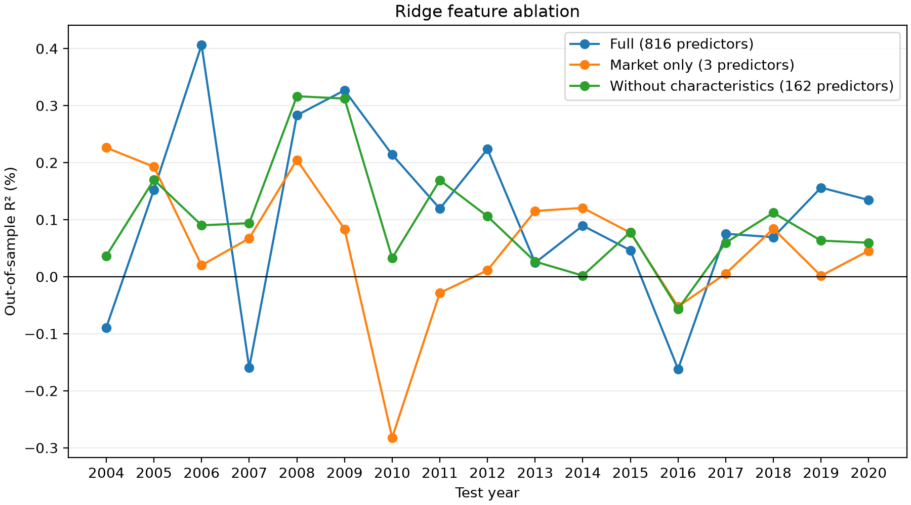

### Market-only penalty sensitivity

Market-only Ridge selected the weakest available penalty in 7 of 17 years.
That raises the possibility that the original grid constrained the simpler
model. The expanded grid keeps the original 100 values and adds 60 smaller
positive values and a zero penalty, which corresponds to ordinary least
squares. Validation selects weaker penalties for those seven years, including
zero in 2009. The other ten selections stay the same. Validation error is at
least as low with the wider grid, but its test score is 0.012 pp lower. Full's
advantage holds under both grids. The trading analysis uses the expanded-grid
benchmark.

### Which years produce the advantage?

The pooled gain leaves open whether Full helped across many years or mainly
in a few. A year's contribution measures how much it adds to the overall
gain. The same calculation also works for groups of days or time slots. Let
$`E_{B,g}`$ and $`E_{F,g}`$ be the sums of squared forecast errors for a
comparison model and Full in group $g$, and let $\mathcal{T}$ be all test
intervals.

```math
\text{Contribution}_g\text{ (pp)}
=100\,\frac{E_{B,g}-E_{F,g}}{\sum_{t\in\mathcal{T}}y_t^2}.
```

The common denominator makes the yearly contributions add up to the pooled
gain. A positive contribution means Full had lower squared error in that
year. The [annual contributions table](results/forecasting/market_sensitivity_2004_2020/annual_contributions.csv)
reports both comparisons:

- **Against expanded-grid market-only Ridge**, Full wins in 9 of 17 years.
  The contributions for 2008, 2009, and 2010 are 0.02067, 0.03152, and
  0.03497 pp. They add to **0.08716 pp**, about **81%** of the 0.10797 pp total.
- **Against Ridge without characteristics**, Full wins in 8 of 17 years.
  The winning years contribute +0.03844 pp and the losing years contribute
  −0.03355 pp, leaving a net gain of about **0.005 pp**.

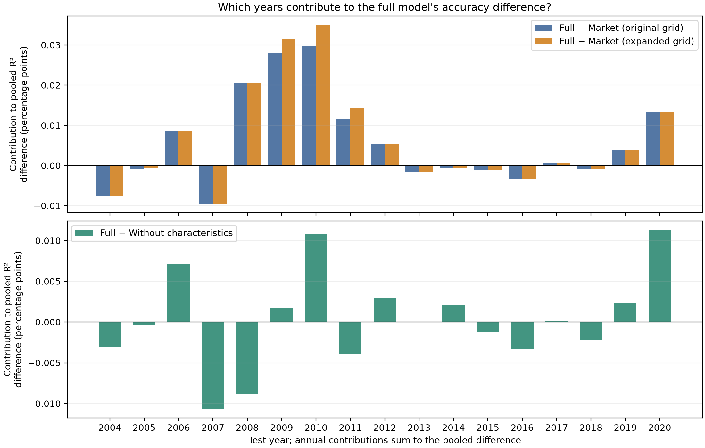

## 6. From forecasts to trading

An $R^2$ of 0.17% is hard to interpret in money terms. This section turns the
saved forecasts into simple trading rules and measures their profits, costs,
and risk. It uses the forecasts already fitted for Full and expanded-grid
market-only Ridge.

The simulation trades the market portfolio as a proxy for a tradable
instrument. It assumes immediate execution at the start of each forecast
interval and closes every position at the end of the session. **Notional** is
the fixed reference dollar amount used to size positions. Profit and loss
(P&L) is measured per dollar of notional and summed without compounding.

### 6.1 Do larger forecasts come before larger returns?

The decile analysis checks whether forecast size carries information. That
motivates the trading rules below that use the size of the forecast. The
[decile chart](#results-at-a-glance) sorts forecasts into tenths within each
test year, so every year contributes observations to both ends of the
ranking. For Full, the mean realized return rises from **−1.35 bp** in the
lowest decile to **+1.35 bp** in the highest. The top-minus-bottom spread is
**2.70 bp** [2.08, 3.31], compared with **2.16 bp** [1.55, 2.78] for
market-only Ridge.

| Direction forecast | Hit rate | 95% interval (%) |
|---|---:|---:|
| Always up | 51.8% | [51.5, 52.1] |
| Full | 50.1% | [49.7, 50.4] |
| Market only | 49.2% | [48.9, 49.5] |

The hit rate excludes zero realized returns and, for each model, zero
forecasts. Always guessing up has the highest hit rate because the market
rose in 51.8% of intervals with nonzero returns. A hit counts every correct
direction equally. In the trading rule below, larger moves contribute more
to P&L, so a hit rate near 50% can still produce positive gross P&L.

### 6.2 A simple trading rule

Start with a rule that uses only the direction of the forecast. The sign rule
goes long one unit of notional for a positive forecast, short one unit for a
negative forecast, and stays flat for a zero forecast. The long-only
benchmark buys one unit at the open and closes it at the end of the session.

Let $w_j$ be the signed position during interval $j$, in units of notional.
Let $y_j$ be the realized simple return and $n_d$ the number of intervals
that day. Each day starts flat, with $w_0=0$.

```math
\begin{aligned}
G_d &= \sum_{j=1}^{n_d} w_j y_j,\\
T_d &= \sum_{j=1}^{n_d} \lvert w_j-w_{j-1}\rvert + \lvert w_{n_d}\rvert,\\
\text{Net PnL}_d &= G_d-cT_d.
\end{aligned}
```

$G_d$ is daily gross P&L per dollar of notional. $T_d$ is daily turnover in
units of notional, including the opening trade and closing trade. Going from
+1 to −1 trades two units, one to close the long and one to open the short.
The cost $c$ is in decimal units per unit traded. The **break-even cost** is
the rate that makes total net P&L zero. Solving for that rate gives
$`\sum_d G_d/\sum_d T_d`$, which is reported in basis points.

The simulation annualizes mean daily P&L by 252 and its sample standard
deviation by $\sqrt{252}$. The reported Sharpe uses zero as the reference
return and divides the annualized mean by the annualized standard deviation.
Drawdown is the largest peak-to-trough drop in cumulative daily P&L, expressed
as a percentage of fixed notional.

| Gross strategy, 2004–2020 | Annualized P&L | Annualized volatility | Sharpe (95% interval) | Max drawdown | Daily turnover |
|---|---:|---:|---:|---:|---:|
| Long only during the session | 2.5% | 15.2% | 0.17 [−0.27, 0.62] | 54.4% | 2.0 |
| Market-only sign | 27.8% | 14.3% | 1.94 [1.50, 2.37] | 15.6% | 18.3 |
| Full sign | **31.3%** | **14.6%** | **2.15 [1.71, 2.58]** | **13.9%** | **16.8** |

Full's sign rule has a gross Sharpe of 2.15, but it trades an average of
16.8 units of notional per day. Even a small charge on each trade adds up.
The rule breaks even at **0.74 bp per unit traded** [0.57, 0.91].

| Cost per unit traded | 0 bp | 0.25 bp | 0.5 bp | 1 bp | 2 bp |
|---|---:|---:|---:|---:|---:|
| Full sign, net Sharpe | 2.15 | 1.42 | 0.69 | −0.74 | −3.48 |
| Market-only sign, net Sharpe | 1.94 | 1.13 | 0.33 | −1.23 | −4.20 |

For illustration, suppose SPY has a one-cent quoted bid–ask spread. Crossing
that spread costs half a cent per share each way relative to the midpoint.
At share prices of \$70–\$370, that works out to about 0.14–0.71 bp per unit
traded, before fees and market impact. In the simulation, Full's sign rule
has a net Sharpe of −0.74 at an assumed total cost of 1 bp per unit traded.

### 6.3 Trading only on strong forecasts

The sign rule takes a full position even for a forecast close to zero.
To see whether skipping weaker signals reduces turnover enough to make up
for missed opportunities, take a position only when the absolute forecast
exceeds a percentile of absolute forecasts from the previous 20 trading days.
The linear rule instead scales the position by the forecast, dividing by the
mean absolute forecast over that same history. Both use the available history
when fewer than 20 prior test days exist and stay flat on the first day.

| Strategy using Full forecasts | Mean absolute position | Daily turnover | Gross Sharpe | Break-even cost | Net Sharpe at 0.5 bp | Net Sharpe at 1 bp |
|---|---:|---:|---:|---:|---:|---:|
| Sign | 1.00 | 16.8 | 2.15 | 0.74 bp | 0.69 | −0.74 |
| Above trailing median | 0.50 | 12.1 | 2.35 | 0.86 bp | 0.98 | −0.37 |
| Above trailing 75th percentile | 0.25 | 7.3 | 2.08 | 0.94 bp | 0.98 | −0.12 |
| Above trailing 90th percentile | 0.10 | 3.4 | 1.66 | **1.10 bp** | 0.90 | **0.15** |
| Linear | 1.01 | 25.1 | 2.22 | 0.85 bp | 0.91 | −0.40 |

The median filter raises gross Sharpe from 2.15 to 2.35 in this sample.
The 90th-percentile rule gives up more gross performance but has about
one-fifth of the sign rule's turnover. At a cost of 1 bp per unit traded, its
net Sharpe is 0.15, compared with −0.74 for the sign rule.

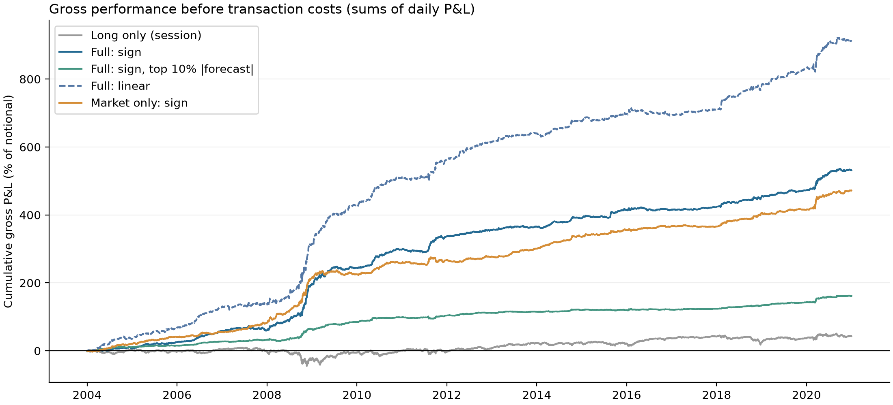

*Each line sums daily gross P&L from the start of the test period.*

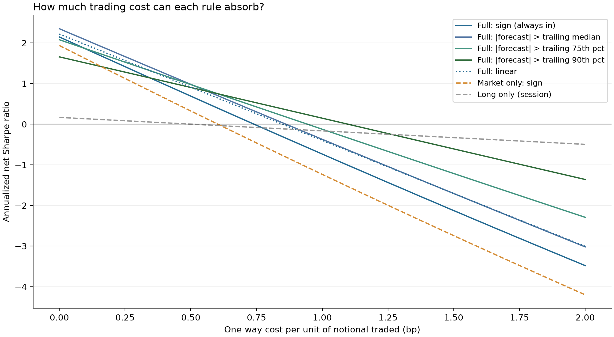

### 6.4 How close is trading performance to what R² implies?

A small per-interval forecasting improvement can add up over many intervals.
To put the measured Sharpe ratios in context, compare them with an idealized
before-cost reference. It assumes the forecast equals the conditional mean
and conditional variance is constant. The calculation scales
$`\sqrt{R^2/(1-R^2)}`$ by the square root of the number of intervals per year,
about 6,540. Negative R² bootstrap draws are clipped to zero for this calculation.

| Forecasts | R² (%) | Implied Sharpe reference | Gross linear Sharpe | Gross sign Sharpe |
|---|---:|---:|---:|---:|
| Full | 0.171 | 3.35 [2.59, 3.96] | 2.22 [1.77, 2.66] | 2.15 [1.71, 2.58] |
| Market only | 0.063 | 2.04 [0, 3.02] | 1.11 [0.58, 1.74] | 1.94 [1.50, 2.37] |

Full's linear rule reaches roughly two-thirds of its idealized reference
(2.22 versus 3.35). The market-only sign and linear rules have different
Sharpe ratios even though they use the same forecasts. The choice of how to
size positions affects how forecast accuracy translates into P&L and risk.

### 6.5 When does the full model help?

Section 5 found that 2008–2010 accounted for about 81% of Full's pooled
forecasting gain over market-only Ridge. Does the gain also appear on
volatile days outside that period? To answer that, estimate each day's
market volatility before the session opens using the previous five trading
days' intraday returns. Here $RV_d$ is the sum of squared 15-minute returns
on day $d$.

```math
RV_d=\sum_{t\in d} y_t^2,
\qquad
\sigma_d=\sqrt{\frac{252}{5}\sum_{k=1}^{5} RV_{d-k}}.
```

The analysis divides test days into three equally sized groups using the
full test sample's volatility cutoffs (about 7.7% and 11.3% annualized). The
daily estimate is available at the open. The full-sample cutoffs make the
groups descriptive.

| Volatility group | Share of squared market returns | R² gain within group (pp) | Contribution to pooled gain (pp) |
|---|---:|---:|---:|
| Low | 8% | −0.048 [−0.167, 0.068] | −0.004 [−0.014, 0.005] |
| Middle | 15% | −0.009 [−0.112, 0.094] | −0.001 [−0.017, 0.014] |
| High | 77% | **0.147 [0.073, 0.234]** | **0.113 [0.056, 0.178]** |

The highest-volatility third accounts for 77% of the zero benchmark's squared
error. That weight explains why a 0.147 pp gain **within** the group
contributes 0.113 pp **to the pooled gain**. The low and middle groups have
small negative point estimates and intervals that include zero.

| Period | Contribution of high-volatility days to the pooled gain (pp) |
|---|---:|
| 2004–2007 | −0.001 [−0.013, 0.009] |
| 2008–2010 | 0.083 [0.033, 0.142] |
| 2011–2020 | **0.032 [0.004, 0.062]** |

High-volatility days made a positive contribution after 2010 as well as in
2008–2010. The earlier period, 2004–2007, shows little evidence of a gain
even on volatile days. This describes where the gain appeared in the
sample. It leaves open what caused the difference across periods.

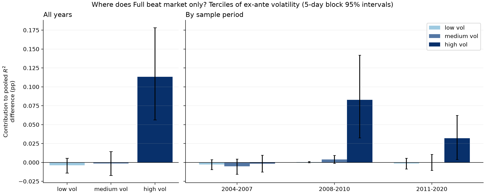

**Time of day.** Full has a positive point estimate relative to market-only
Ridge in 19 of 26 time slots. The first hour contributes about +0.033 pp,
the middle of the session +0.112 pp, and the last hour −0.037 pp. The final
interval (15:45–16:00 Eastern) accounts for nearly all of the last hour's
shortfall, at −0.038 pp [−0.060, −0.017]. The slot intervals are individual
intervals without a multiple-comparison adjustment.

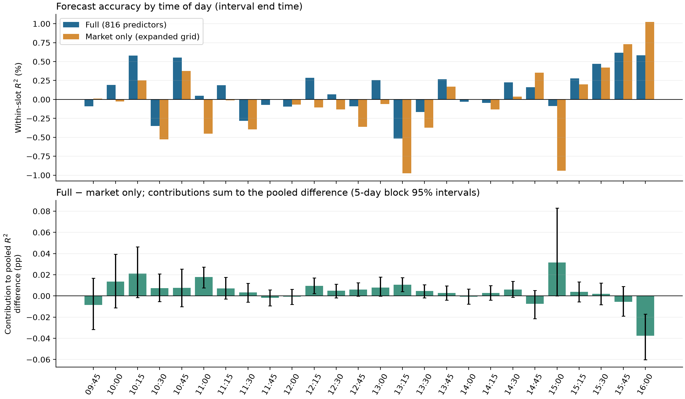

## 7. Limitations

- **Uncertainty.** The bootstrap measures variation across sampled test days.
  The intervals hold the fitted forecasts fixed and therefore do not capture
  uncertainty from refitting the models on different training data. Reported
  intervals are individual 95% percentile intervals based on five-day blocks
  unless stated otherwise. When looking across 26 time slots, some intervals
  may exclude zero by chance.
- **Exploratory comparisons.** The extensions were developed using the
  2004–2020 results, and the 2008–2010 period was singled out after seeing
  the yearly contributions. A later, untouched period would provide an
  independent test of these choices.
- **Volatility groups use future information.** Each day's volatility
  estimate is known at the open, but the cutoffs between the low, middle, and
  high groups come from the whole 2004–2020 test sample. The split describes
  the past and could not have been used to trade in real time.
- **Execution.** The market portfolio is a proxy for a tradable instrument.
  The simulation assumes immediate fills and a flat cost per unit traded.
  Actual results depend on executable prices, fees, shorting costs, market
  impact, and capacity.

## 8. Reproduce the analysis

### Environment and inputs

Use Python 3.13 or later and [uv](https://docs.astral.sh/uv/) from the
repository root. The synthetic-data tests run without the source returns.
[GitHub Actions](.github/workflows/ci.yml) runs the same lint, format and test
commands.

```powershell
uv sync --locked
uv run ruff check src tests notebooks
uv run ruff format --check src tests notebooks
uv run pytest
```

Full reproduction requires 300 monthly Parquet files, `199601.parquet` through
`202012.parquet`, in `data/simple_returns_1min/`. Each file needs a sorted,
unique datetime index in exchange-local time, finite decimal simple returns,
and the same 272 columns:

- Six Fama–French and momentum columns with prefix `ff__` and suffixes
  `mkt`, `smb`, `hml`, `rmw`, `cma` and `umd`.
- 48 industry columns with prefix `ind48__`.
- 218 characteristic columns with prefixes `cz__` (65) and `jkp__` (153).

Keep the 09:30 overnight observation in each file. The descriptive notebook
also needs `docs/factor_cite_info_fmt.xlsx` for factor names and signs and
`docs/cluster_classifications.csv` for the characteristic groups. See the
authors' [replication materials](https://pubsonline.informs.org/doi/suppl/10.1287/mnsc.2023.01657)
for data context and access. The repository includes saved figures and summary
tables. Source returns and the authors' metadata are obtained separately.

### Descriptive analysis

```powershell
uv sync --locked --group notebooks
uv run --group notebooks jupyter lab notebooks/01_descriptive_analysis.ipynb
```

Run the notebook from top to bottom in a fresh kernel.

### Build features and fit models

```powershell
uv run python -m hf_factor_zoo.data_processing
uv run python -m hf_factor_zoo.build_features
uv run python -m hf_factor_zoo.forecasting --model ridge
uv run python -m hf_factor_zoo.forecasting --model lasso
uv run python -m hf_factor_zoo.forecasting --model elastic_net
```

The forecast commands default to 2004–2020. Use `--first-year 2004 --last-year 2004`
for a one-year check.

### Evaluate

```powershell
uv run python -m hf_factor_zoo.compare_forecast
uv run python -m hf_factor_zoo.bootstrap_forecast
uv run python -m hf_factor_zoo.feature_ablation --last-year 2020
uv run python -m hf_factor_zoo.market_sensitivity --last-year 2020
uv run python -m hf_factor_zoo.strategy_evaluation
```

Run these commands in order. Ablation refits the reduced models and defaults
to 2004, so pass `--last-year 2020` for the full study. Sensitivity expands the
market-only penalty grid. The strategy evaluation uses the saved predictions,
the sensitivity results, and the local feature panel. Use `--n-replicates 50`
for a quick strategy check.

### Automated tests

The synthetic tests check that changing future returns leaves earlier
features intact, that scalers use only training rows, and that the bootstrap
keeps consecutive days together within each block. They also compare
turnover, P&L, and Sharpe against direct calculations. The pipeline checks
that the models use identical test timestamps and targets and that the year,
volatility, and time-of-day contributions sum to the pooled gain.

## 9. Repository guide

| Path | Purpose |
|---|---|
| [Descriptive notebook](notebooks/01_descriptive_analysis.ipynb) | Portfolio statistics, market return profile, and dependence heatmaps |
| [Data processing](src/hf_factor_zoo/data_processing.py) and [feature builder](src/hf_factor_zoo/build_features.py) | Aggregate 15-minute returns and build the forecast panel |
| [Forecasting](src/hf_factor_zoo/forecasting.py) and [comparison](src/hf_factor_zoo/compare_forecast.py) | Annual fitting, validation, and paired forecast comparison |
| [Bootstrap](src/hf_factor_zoo/bootstrap_forecast.py) | Pooled scores and paired intervals |
| [Ablation](src/hf_factor_zoo/feature_ablation.py) and [sensitivity](src/hf_factor_zoo/market_sensitivity.py) | Predictor-group comparisons, the expanded penalty grid, and yearly contributions |
| [Strategy evaluation](src/hf_factor_zoo/strategy_evaluation.py) | Forecast deciles, trading rules, costs, and regime and time-of-day comparisons |
| [Descriptive results](results/descriptive/) and [forecasting results](results/forecasting/) | Figures and summary tables |
| [Tests](tests/) | Synthetic-data checks |

**Reference.** Aleti, S., Bollerslev, T., and Siggaard, M. (2025).
[Intraday Market Return Predictability Culled from the Factor Zoo](https://doi.org/10.1287/mnsc.2023.01657).
*Management Science*, 71(9), 7731–7751.
